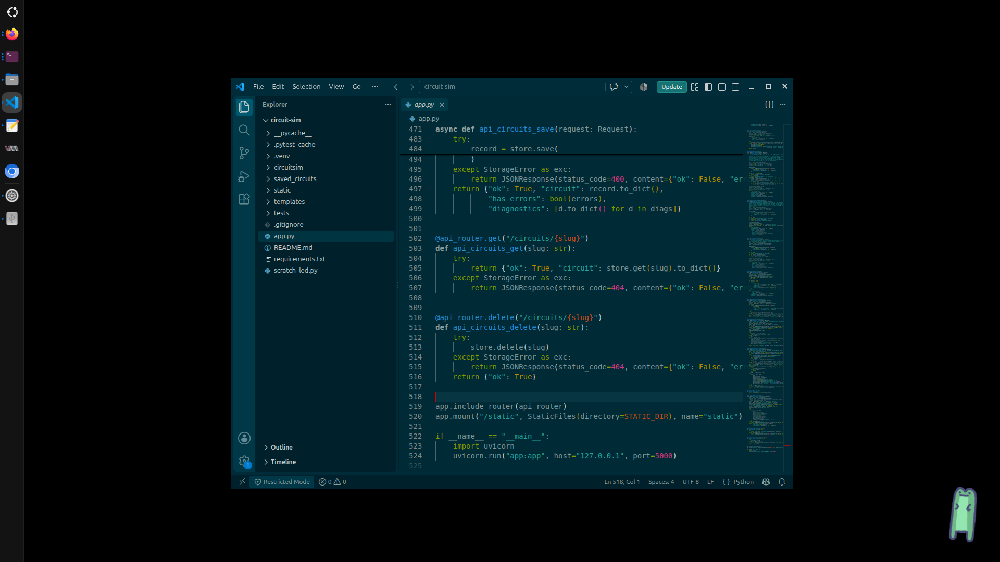

# Freg Desktop Pal

Freg is a little desktop assistant inspired by clippy. I drew the frog in like 5 mins, its not very good lol


Freg is a little desktop frog that sits in the corner of your screen and talks to a coding
agent: Claude Code or [pi](https://pi.dev).
Click Freg to ask a question and the reply appears as speech bubbles. When nobody is talking to Freg, it tells the odd pun, takes naps and dances.

Here an example of freg on my desktop



Every conversation is a real agent session, so you can move a chat to a terminal
whenever it outgrows the speech bubbles.

## Requirements

- Linux with an X11 or XWayland desktop. Freg forces `GDK_BACKEND=x11`, because GNOME on
  Wayland won't let apps position their own windows or stay on top.
- A compositor, for the transparent window.
- Python 3 with GTK 3 bindings (PyGObject) and pycairo.
- At least one agent, installed and signed in:
  - [Claude Code](https://claude.com/claude-code). Freg looks for `claude` on your `PATH`,
    then in `~/.local/bin/claude`.
  - [pi](https://pi.dev). Freg looks for `pi` on your `PATH`, then in `~/.local/bin/pi`,
    then in nvm's Node folders (`~/.nvm/versions/node/*/bin/pi`). Run `/login` inside pi
    once to connect a provider.

On Debian or Ubuntu:

```sh
sudo apt install python3-gi python3-gi-cairo gir1.2-gtk-3.0
```

## Running

```sh
python3 freg_helper.py
```

Starting Freg again while it's already running opens the ask box instead of a second frog.

### Start on login

```sh
cp freg-helper.desktop ~/.config/autostart/
```

The `Exec=` line in `freg-helper.desktop` contains the absolute path to `freg_helper.py`.
If you move the project, update that line.

## Using Freg

| Action | What it does |
| --- | --- |
| Click Freg | Open the ask box. Press Enter to send and Esc to close it. |
| Click a speech bubble | Show the next part of the reply. |
| Drag Freg | Move Freg around the screen. |
| Right-click Freg | Open the menu. |

The right-click menu has these options:

- **Ask Freg…**: opens the ask box.
- **Continue in terminal**: reopens the conversation in ptyxis, GNOME Terminal, Console
  or Konsole, with `claude --resume <session-id>` or `pi --session <session-id>`.
- **New conversation**: starts a new session.
- **Agent**: switches between Claude Code and pi. Switching starts a new conversation.
- **Quiet mode**: stops the random quips.
- **Idle antics**: turns the naps and dancing on or off.
- **Nap time / Wake up!** and **Dance!**: make Freg nap, wake up or dance right away.
- **Move back to corner** and **Quit Freg**.

## Configuration

Set these environment variables before you start Freg:

| Variable | Default | Purpose |
| --- | --- | --- |
| `FREG_AGENT` | `claude` | Agent to start with: `claude` or `pi`. |
| `FREG_WORKDIR` | `~` | Directory that the agent runs in. |
| `FREG_MODEL` | the agent's default | Model to use, for example `sonnet`. |
| `FREG_DEBUG` | unset | Set it to any value to print debug logs. |

For example:

```sh
FREG_AGENT=pi FREG_WORKDIR=~/projects python3 freg_helper.py
```

Sizes, timings, quips and the colour theme are constants near the top of
`freg_helper.py`.

## Assets

The sprites and the font are in `assets/`:

| File | Used for |
| --- | --- |
| `frog.png` | Freg standing |
| `blink.png` | Freg blinking |
| `speaking1.png` … `speaking6.png` | Mouth frames while Freg talks |
| `sleep_frame1.png` … `sleep_frame3.png` | Nap animation |
| `arms.png` | Second dance pose |
| `Ldfcomicsans.ttf` | Font for the speech bubbles |

Sprites are scaled to `SPRITE_H` (110 px). You can add or remove numbered speaking
frames and sleep frames: Freg loads whichever frames it finds. If `arms.png` is missing,
the dance option is turned off. If there are no sleep frames, the nap option is turned off.
